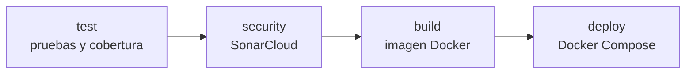

# Order Manager

[](https://github.com/jhonnylarry/order-manager/actions/workflows/ci-cd.yml)

API REST para gestionar pedidos de un e-commerce, contenerizada con Docker, orquestada con Docker Compose y entregada mediante un pipeline CI/CD en GitHub Actions. Proyecto de la Evaluación Parcial N°2 de Ingeniería DevOps (DOY0101).

## Tabla de contenidos

1. [Descripción del proyecto](#descripción-del-proyecto)
2. [Stack tecnológico](#stack-tecnológico)
3. [Arquitectura](#arquitectura)
4. [Requisitos previos](#requisitos-previos)
5. [Ejecución local](#ejecución-local)
6. [Ejecución con Docker](#ejecución-con-docker)
7. [Endpoints de la API](#endpoints-de-la-api)
8. [Pruebas y cobertura](#pruebas-y-cobertura)
9. [Contenedores](#contenedores)
10. [Perfiles y persistencia](#perfiles-y-persistencia)
11. [Orquestación con Docker Compose](#orquestación-con-docker-compose)
12. [Pipeline CI/CD](#pipeline-cicd)
13. [Trazabilidad y calidad](#trazabilidad-y-calidad)
14. [Flujo de trabajo con Git](#flujo-de-trabajo-con-git)
15. [Evidencias de verificación](#evidencias-de-verificación)
16. [Uso de inteligencia artificial](#uso-de-inteligencia-artificial)
17. [Reflexiones individuales](#reflexiones-individuales)
18. [Autores](#autores)

## Descripción del proyecto

Order Manager permite crear pedidos, agregarles ítems y avanzar su estado hasta la entrega. Cada pedido calcula su total a partir de los subtotales de sus ítems.

Funcionalidades:

- Crear pedidos con validación de datos de entrada.
- Agregar ítems a un pedido mientras está en estado `PENDING`.
- Listar todos los pedidos, filtrarlos por estado o consultarlos por id.
- Avanzar el pedido: `PENDING` → `CONFIRMED` → `SHIPPED` → `DELIVERED`, o cancelarlo (salvo que esté entregado o ya cancelado).
- Eliminar pedidos.

Objetivos de la evaluación que cubre el proyecto:

| Indicador | Qué se implementó |
|---|---|
| IE1 – Contenedores | Dockerfile multi-stage, usuario no root, healthcheck y `.dockerignore` |
| IE2 – Pruebas automatizadas | 47 pruebas con JaCoCo y una cobertura mínima exigida en el pipeline |
| IE3 – Seguridad y escalabilidad | SonarCloud con quality gate, Dependabot, secretos fuera del código y límites de recursos |
| IE4 – Despliegue y trazabilidad | Despliegue automático con Docker Compose, imagen etiquetada con el commit y entornos `staging` y `production` |
| IE5 – Orquestación | Docker Compose con aplicación y PostgreSQL, arranque ordenado y datos persistentes |

## Stack tecnológico

| Área | Tecnología |
|---|---|
| Lenguaje y framework | Java 17, Spring Boot 3.3.4 (Web, Data JPA, Validation, Actuator) |
| Base de datos | H2 en memoria (desarrollo y pruebas), PostgreSQL 16 (Docker) |
| Pruebas | JUnit 5, Mockito, Spring Boot Test (MockMvc), JaCoCo |
| Contenedores | Docker (multi-stage), Docker Compose |
| CI/CD | GitHub Actions |
| Seguridad y calidad | SonarCloud, Dependabot |

## Arquitectura

Arquitectura en capas:

```
Cliente HTTP
    │
    ▼
OrderController   (REST, validación de entrada, códigos HTTP)
    │
    ▼
OrderService      (reglas de negocio y transiciones de estado)
    │
    ▼
OrderRepository   (Spring Data JPA)
    │
    ▼
Order ──< OrderItem   (entidades)
```

- `GlobalExceptionHandler` traduce las excepciones a respuestas JSON: 404 (no existe), 409 (transición de estado inválida), 400 (datos inválidos) y 500 (error inesperado).
- En desarrollo se usa H2 en memoria. En Docker se activa el perfil `docker`, que usa PostgreSQL con persistencia real.

## Requisitos previos

- Java 17 y Maven 3.9 o superior (ejecución local)
- Docker y Docker Compose v2 (ejecución con contenedores)
- Git

## Ejecución local

```bash
git clone https://github.com/jhonnylarry/order-manager.git
cd order-manager
mvn spring-boot:run
```

La API queda en `http://localhost:8098`. La consola de H2 está en `http://localhost:8098/h2-console` (JDBC URL `jdbc:h2:mem:orderdb`, usuario `sa`, sin contraseña).

## Ejecución con Docker

```bash
cp .env.example .env        # editar y definir una contraseña propia para POSTGRES_PASSWORD
docker compose up -d --build
docker compose ps           # ambos servicios deben aparecer como "healthy"
docker compose logs -f app  # logs de la aplicación
docker compose down         # detener y eliminar contenedores (los datos se conservan)
docker compose down -v      # además elimina el volumen y borra los datos
```

El archivo `.env` está en `.gitignore`: las credenciales nunca se suben al repositorio. Si falta alguna variable obligatoria, `docker compose` falla con un mensaje claro.

## Endpoints de la API

Base: `http://localhost:8098/api/orders`

| Método | Ruta | Descripción | Respuestas |
|---|---|---|---|
| GET | `/api/orders` | Lista todos los pedidos | 200 |
| GET | `/api/orders/{id}` | Obtiene un pedido | 200, 404 |
| GET | `/api/orders/status/{status}` | Filtra por estado | 200 |
| POST | `/api/orders` | Crea un pedido | 201, 400 |
| POST | `/api/orders/{id}/items` | Agrega un ítem (solo `PENDING`) | 200, 400, 404, 409 |
| PUT | `/api/orders/{id}/confirm` | `PENDING` → `CONFIRMED` | 200, 404, 409 |
| PUT | `/api/orders/{id}/ship` | `CONFIRMED` → `SHIPPED` | 200, 404, 409 |
| PUT | `/api/orders/{id}/deliver` | `SHIPPED` → `DELIVERED` | 200, 404, 409 |
| PUT | `/api/orders/{id}/cancel` | Cancela el pedido | 200, 404, 409 |
| DELETE | `/api/orders/{id}` | Elimina el pedido | 204, 404 |
| GET | `/actuator/health` | Estado de salud | 200 |

Ejemplos:

```bash
# Crear un pedido con un ítem
curl -X POST http://localhost:8098/api/orders \
  -H 'Content-Type: application/json' \
  -d '{"customerName":"Ana","items":[{"productName":"Mouse","quantity":2,"unitPrice":10.50}]}'

# Listar pedidos
curl http://localhost:8098/api/orders

# Confirmar el pedido 1
curl -X PUT http://localhost:8098/api/orders/1/confirm
```

## Pruebas y cobertura

```bash
mvn clean test          # ejecuta las pruebas
mvn clean verify        # además genera el reporte de JaCoCo
```

El reporte HTML queda en `target/site/jacoco/index.html`.

El repositorio incluía 24 pruebas (servicio y controlador) que cubrían un **69,5%** del total, por debajo del mínimo de 70%. Se agregaron 23 pruebas nuevas para el modelo (`Order`, `OrderItem`) y para los endpoints del controlador que no estaban cubiertos.

| Métrica (total global de la aplicación) | Solo pruebas entregadas | Con las pruebas agregadas |
|---|---|---|
| Instrucciones | 69,5% | **98,4%** |
| Líneas | 73,8% | 97,8% |
| Ramas | 44,4% | 98,1% |
| Cantidad de pruebas | 24 | **47** (0 fallos, 0 errores, 0 omitidas) |

El valor de referencia es el porcentaje total de instrucciones. El pipeline verifica que supere el mínimo de 70% y detiene la ejecución si no se cumple.

## Contenedores

El `Dockerfile` usa dos etapas:

1. **build**: compila el JAR con Maven y JDK 17. Copia primero el `pom.xml` para reutilizar la capa de dependencias mientras no cambie.
2. **runtime**: ejecuta solo el JAR sobre un JRE 17 en Alpine (`bellsoft/liberica-openjre-alpine:17`). Las herramientas de compilación no quedan en la imagen final.

Decisiones:

- **Usuario no root**: el contenedor corre con el usuario `spring`, sin privilegios.
- **Healthcheck** contra `/actuator/health`: permite a Compose saber cuándo la aplicación está lista.
- **`.dockerignore`**: excluye `target/`, `.git`, `.github/`, documentación, configuración de IDE, logs y archivos `.env`, para acelerar el build y evitar que secretos entren a la imagen.
- **Imagen base multi-arquitectura**: se eligió Liberica porque publica variantes amd64 y arm64, lo que permite construir tanto en el pipeline como en equipos Apple Silicon. `eclipse-temurin:17-jre-alpine` solo publica amd64.

Tamaño de la imagen final: 279 MB.

## Perfiles y persistencia

| Perfil | Base de datos | Uso |
|---|---|---|
| por defecto | H2 en memoria | desarrollo y pruebas |
| `docker` | PostgreSQL 16 | contenedores |

Con H2 en memoria los datos se pierden al reiniciar. El perfil `docker` (`application-docker.properties`) se activa con `SPRING_PROFILES_ACTIVE=docker`, se conecta a PostgreSQL y usa `ddl-auto=update` para conservar los datos. Usuario y contraseña se leen de las variables `DB_USER` y `DB_PASSWORD`, sin valores por defecto en el código.

## Orquestación con Docker Compose

`docker-compose.yml` define dos servicios:

| Servicio | Imagen | Detalle |
|---|---|---|
| `app` | construida con el `Dockerfile` | puerto 8098, perfil `docker`, espera a que la base esté saludable |
| `db` | `postgres:16-alpine` | volumen `order-db-data`, healthcheck con `pg_isready`, sin puertos publicados |

- **Arranque ordenado**: `depends_on` con `condition: service_healthy`.
- **Persistencia**: volumen nombrado para `/var/lib/postgresql/data`.
- **Escalabilidad y recursos**: límites y reservas de CPU y memoria por servicio (`app`: 1 CPU y 512 MB, con 0,25 CPU y 256 MB reservados; `db`: 0,5 CPU y 512 MB).
- **Resiliencia**: política de reinicio `unless-stopped`.
- **Seguridad**: la base de datos no se expone al host; solo la API es accesible. Las credenciales son variables obligatorias.
- **Red**: red `bridge` propia (`order-net`).

## Pipeline CI/CD

Definido en `.github/workflows/ci-cd.yml`. Se ejecuta con cada `push` a `main` o `develop` y con cada pull request hacia `main`.



| Etapa | Qué hace | Se bloquea si |
|---|---|---|
| `test` | `mvn clean verify`, reporte JaCoCo y verificación de cobertura mínima de 70% | falla una prueba o la cobertura es menor a 70% |
| `security` | análisis en SonarCloud con `sonar.qualitygate.wait=true` | el quality gate no se cumple |
| `build` | construye la imagen con etiquetas de trazabilidad y la guarda comprimida como artefacto (7 días) | falla la construcción |
| `deploy` | carga la imagen, levanta `app` y `db` con Compose, espera el estado `healthy` y ejecuta una prueba de humo | la app no queda saludable o la prueba de humo falla |

Cada etapa usa `needs` sobre la anterior, por lo que si una falla, las siguientes no se ejecutan. El despliegue corre solo en `push`, no en pull requests.

**Entorno simulado**: el despliegue ocurre en el runner de GitHub Actions con Docker Compose, con credenciales efímeras generadas en cada ejecución. Al terminar, el entorno se elimina.

**Dependabot** (`.github/dependabot.yml`) revisa cada lunes las dependencias de Maven, las imágenes del `Dockerfile` y de `docker-compose.yml`, y las acciones de GitHub Actions, y abre pull requests con las actualizaciones.

**Secretos**: `SONAR_TOKEN` está configurado como secret del repositorio. No hay credenciales en el código.

**Artefactos** de cada ejecución: `jacoco-report` (reporte de cobertura) y `docker-image` (imagen construida).

**Alertas**: cuando una etapa falla, GitHub marca la ejecución en rojo, detiene el pipeline y envía una notificación a quien la disparó, según su configuración de notificaciones.

Análisis de calidad en SonarCloud: https://sonarcloud.io/project/overview?id=jhonnylarry_order-manager

## Trazabilidad y calidad

**Trazabilidad** (del desarrollo a producción):

- Cada cambio entra por un pull request desde una rama `feature/*`, con commits descriptivos que explican qué cambió y por qué.
- La imagen Docker se etiqueta con el SHA del commit y registra el repositorio de origen mediante etiquetas OCI (`org.opencontainers.image.revision` y `org.opencontainers.image.source`).
- El despliegue usa los entornos de GitHub `staging` (rama `develop`) y `production` (rama `main`). GitHub registra qué commit llegó a cada entorno y cuándo.
- Cada despliegue deja en el resumen de la ejecución el entorno, el commit, la imagen y el enlace a la ejecución.
- La imagen y el reporte de cobertura quedan como artefactos de la ejecución que los generó.

**Calidad**:

- Cobertura total de 98,4% con 47 pruebas, y un mínimo de 70% exigido automáticamente.
- Análisis estático y quality gate de SonarCloud antes de construir la imagen.
- Dependabot mantiene actualizadas las dependencias y detecta vulnerabilidades conocidas.
- Imagen mínima, sin herramientas de compilación, ejecutada con un usuario sin privilegios.

## Flujo de trabajo con Git

Se aplicó GitFlow: `main` (producción), `develop` (integración) y una rama `feature/*` por cada fase, integrada mediante pull request.

| Rama | Contenido |
|---|---|
| `feature/pruebas-jacoco` | pruebas adicionales y cobertura |
| `feature/dockerfile` | Dockerfile y `.dockerignore` |
| `feature/perfil-docker` | perfil `docker` con PostgreSQL |
| `feature/docker-compose` | orquestación con Docker Compose |
| `feature/pipeline-cicd` | Dependabot, SonarCloud y pipeline |
| `docs/informe-readme` | este documento |

Convención de commits: `tipo: resumen` (`feat`, `test`, `build`, `ci`, `docs`), con un cuerpo que explica qué cambia y por qué.

## Evidencias de verificación

Salidas reales de los comandos ejecutados durante el desarrollo.

**Pruebas y cobertura**

```
Tests run: 47, Failures: 0, Errors: 0, Skipped: 0
BUILD SUCCESS
Cobertura total de instrucciones: 98,4% (mínimo exigido: 70%)
```

**Imagen y usuario no root**

```
$ docker image ls order-manager
order-manager:1.0.0   279MB
$ docker exec om-test whoami
spring
```

**Servicios orquestados** (`docker compose ps`)

```
order-manager-app   Up 12 seconds (healthy)   0.0.0.0:8098->8098/tcp
order-manager-db    Up 23 seconds (healthy)   5432/tcp
```

**Perfil `docker` y base de datos**

```
The following 1 profile is active: "docker"
HikariPool-1 - Added connection org.postgresql.jdbc.PgConnection
/actuator/health -> estado: UP | base: PostgreSQL
```

**Datos en PostgreSQL** (consulta directa con `psql`)

```
 id | customer_name | status  | total_amount
----+---------------+---------+--------------
  1 | Ana           | PENDING |        21.00
  2 | Luis          | PENDING |         0.00
```

**Persistencia**: tras `docker compose down` (sin `-v`) y `docker compose up`, los dos pedidos siguen disponibles.

## Uso de inteligencia artificial

Para esta evaluación utilicé Claude Code, como asistente de desarrollo. Lo apliqué en la redacción de las pruebas unitarias adicionales, de los archivos de contenedores y despliegue (Dockerfile, docker-compose.yml, perfil docker), orientacion para configrarcion del pipeline de GitHub Actions con Dependabot y SonarCloud. También me apoyó para diagnosticar y corregir las fallas de las primeras ejecuciones del pipeline.

Yo creé las cuentas y credenciales necesarias, revisé los cambios, ejecuté y verifiqué los resultados, y aprobé cada pull request antes de integrarlo.

## Reflexiones individuales

El desarrollo de este proyecto marca mi transición definitiva de la simple programación a la verdadera ingeniería de software bajo una cultura DevOps. Implementar un flujo de trabajo estricto con GitFlow, sumado a la contenedorización con Docker y la orquestación con Docker Compose, me permitió comprender la importancia de la paridad de entornos, eliminando por fin el problema de "en mi máquina sí funciona".
El mayor aprendizaje técnico fue la automatización temprana. Configurar pipelines de CI/CD en GitHub Actions y establecer barreras de calidad innegociables —como el Quality Gate de SonarCloud y la exigencia de un 98% de cobertura con JaCoCo— cambia la mentalidad: la seguridad y la estabilidad se validan desde el primer commit, no al final del proceso.
En conclusión, aunque el uso de herramientas e IA agilizó la escritura y configuración, el proyecto me demostró que las decisiones arquitectónicas, la resolución manual de conflictos y la responsabilidad final sobre un entorno productivo robusto dependen enteramente de mi propio criterio técnico. Todo este ecosistema garantiza que el paso de desarrollo a producción sea rápido, trazable y, sobre todo, seguro.

## Autores

- Jonathan Larraguibel ([@jhonnylarry](https://github.com/jhonnylarry))

Trabajo para el ramo Ingeniería DevOps (DOY0101), Duoc UC.
