# Informe Evaluación Parcial N°3 – Ingeniería DevOps (DOY0101)

**Estudiante:** Jonathan Larraguibel · **Repositorio:** https://github.com/jhonnylarry/order-manager

Monitoreo, orquestación en Kubernetes, métricas dentro del pipeline CI/CD y controles de cumplimiento para la API Order Manager.

## Contenido

| Indicador | Sección |
|---|---|
| IE1 – Monitoreo | [Monitoreo y trazabilidad](#2-monitoreo-y-trazabilidad-ie1) |
| IE2 – Orquestación | [Despliegue en Kubernetes](#1-despliegue-en-kubernetes-ie2) |
| IE3 – Dashboard | [Dashboard](#3-dashboard-ie3) |
| IE4 – Integración y decisiones | [Pipeline](#4-integración-en-el-pipeline-ie4) y [uso de la información](#7-uso-de-la-información-para-decidir-ie4) |
| IE5 – Cumplimiento | [Políticas de cumplimiento](#5-políticas-de-cumplimiento-ie5) |
| IE6 – Bloqueo | [Detención ante fallas críticas](#6-detención-ante-fallas-críticas-ie6) |

## 1. Despliegue en Kubernetes (IE2)

El mismo conjunto de manifiestos (`k8s/`) se despliega en dos entornos:

| Entorno | Clúster | Cómo se despliega |
|---|---|---|
| Pipeline (`preview`, `staging`, `production`) | kind, creado y eliminado en cada ejecución | automático, etapa `deploy` |
| AWS Academy | k3s sobre dos instancias EC2 | con los scripts de `infra/aws/` |

El despliegue en AWS se lanza manualmente porque las credenciales del laboratorio son temporales y cambian en cada sesión.

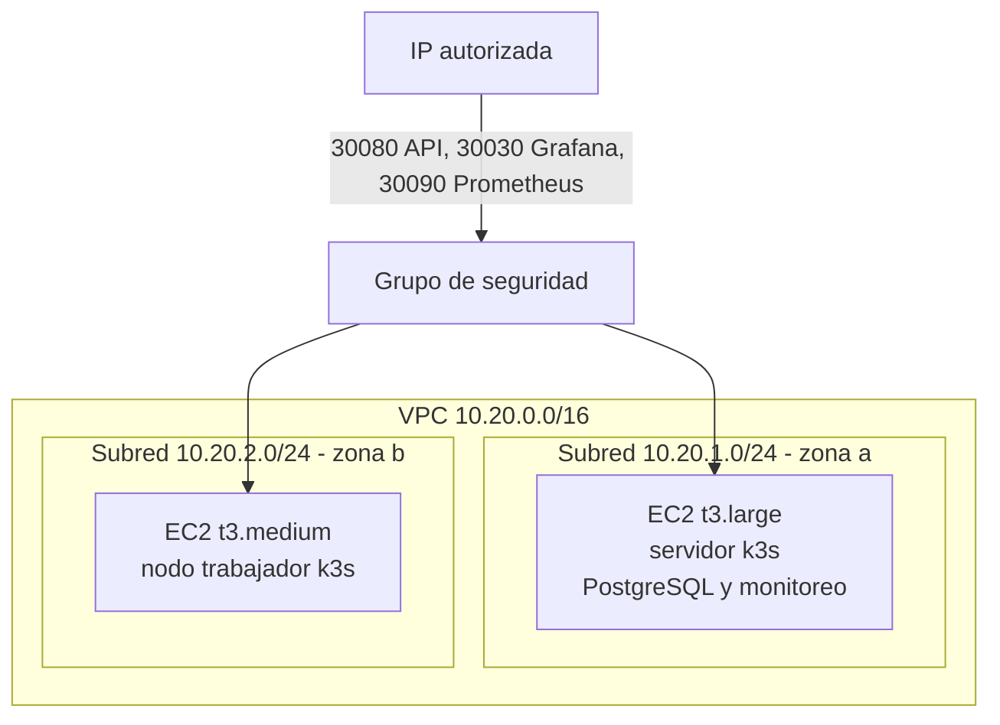

| Elemento | Configuración |
|---|---|
| Espacios de nombres | `order-manager` (API y base de datos) y `monitoring` |
| API | Deployment con actualización progresiva, sondas de arranque, disponibilidad y vida, y límites de recursos |
| Escalado | HorizontalPodAutoscaler de 1 a 3 réplicas según CPU (70%) |
| Base de datos | PostgreSQL 16 con volumen persistente, accesible solo dentro del clúster |
| Credenciales | Secrets generados al desplegar; no se guardan en el repositorio |
| Seguridad del pod | Usuario no root, sin escalada de privilegios ni capacidades adicionales |
| Ajustes en AWS | Monitoreo y base de datos fijos en el servidor; la API se reubica a los 30 s si su nodo cae (`infra/aws/k8s/`) |

Scripts de infraestructura: `infra/aws/crear.sh` (crea red, instancias y clúster), `estado.sh` (consulta) y `eliminar.sh` (borra todo).

### Infraestructura creada en AWS

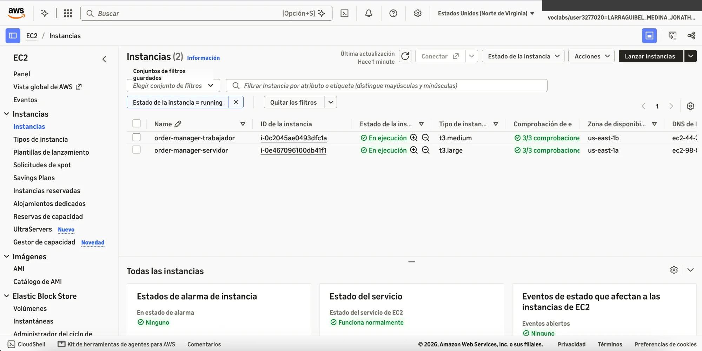

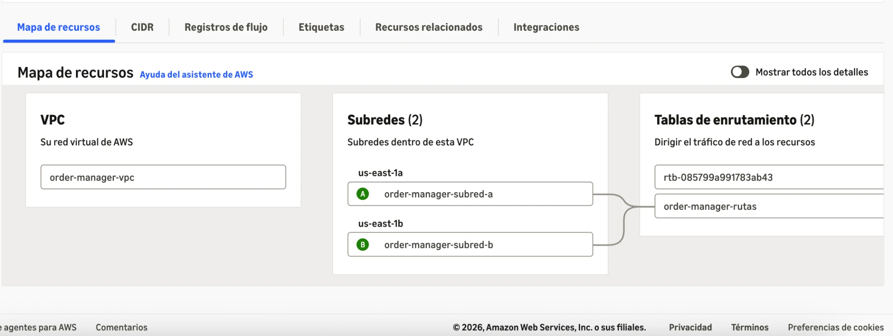

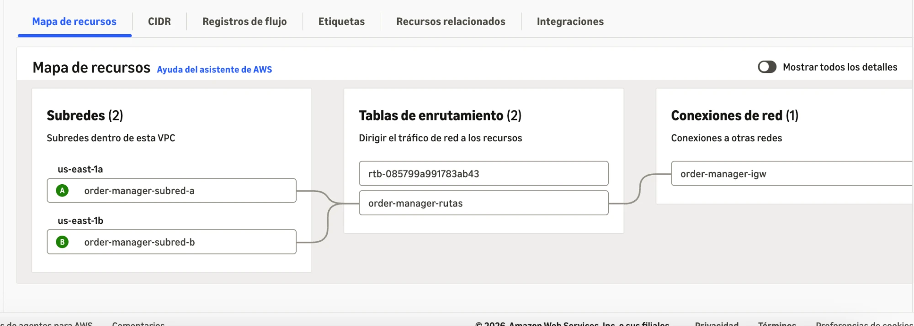

Detalle de cada nodo: [servidor](evidencias/ep3/08-aws-servidor.png) · [trabajador](evidencias/ep3/09-aws-trabajador.png)

### Prueba de caída del nodo trabajador

| Hora | Desde el inicio | Evento |
|---|---|---|
| 16:56:36 | 0 s | Se detiene el nodo trabajador |
| 16:56:38 | 2 s | La API deja de responder |
| 16:57:53 | 77 s | Prometheus dispara `AplicacionNoDisponible` |
| 16:58:24 | 108 s | La API responde desde un pod nuevo en el servidor |
| 16:58:44 | 128 s | Se vuelve a iniciar el trabajador |
| 16:59:35 | 179 s | Ambos nodos en `Ready` |

Registros: [línea de tiempo](evidencias/ep3/10-caida-linea-de-tiempo.txt) · [nodo detenido](evidencias/ep3/13-cluster-caida.txt) · [aplicación reubicada](evidencias/ep3/14-cluster-reubicado.txt) · [nodos recuperados](evidencias/ep3/16-cluster-despues.txt)

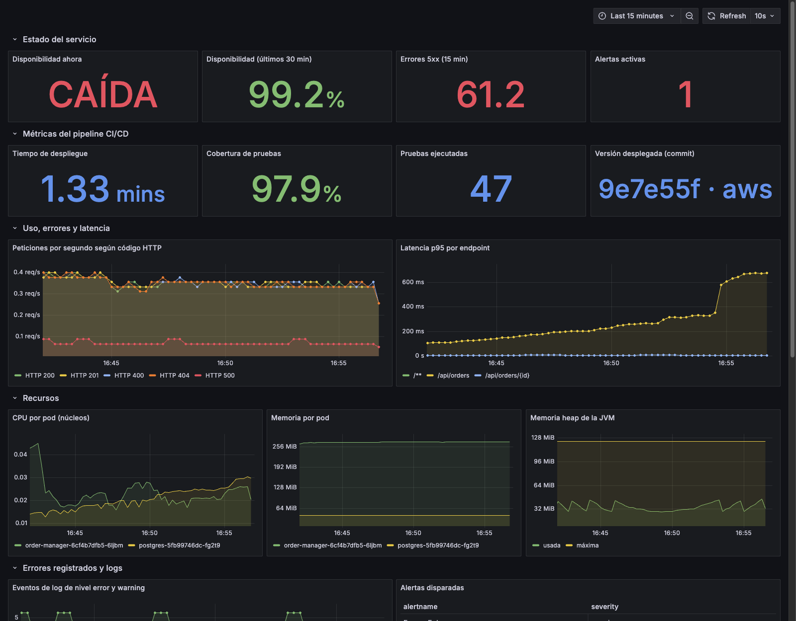

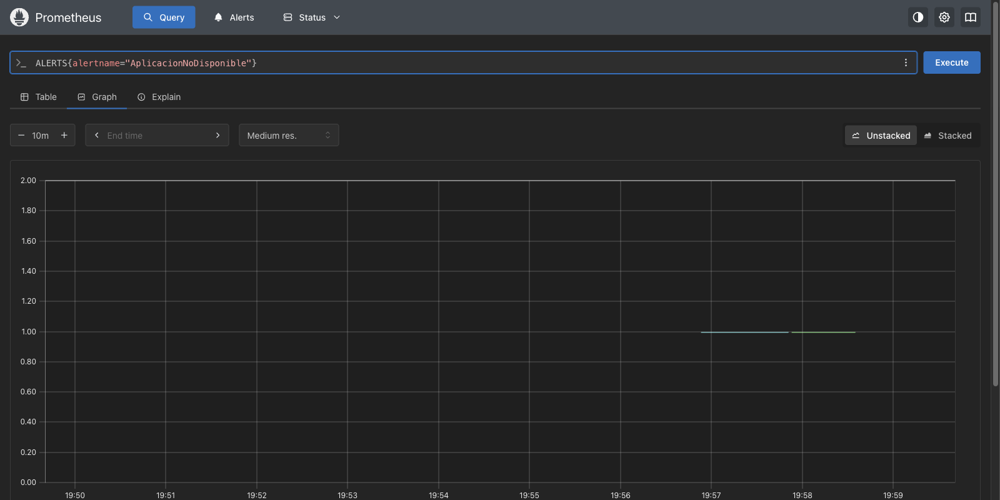

La prueba cubre la caída del trabajador. La base de datos y el monitoreo se ejecutan en el servidor, por lo que no cubre la caída de ese nodo.

La prueba se repitió deteniendo el trabajador desde la consola de AWS, ya con la versión `5ba1503`: el nodo quedó `NotReady` y la aplicación volvió a responder desde un pod nuevo en el servidor ([registro](evidencias/ep3/19-cluster-nodo-detenido.txt)).

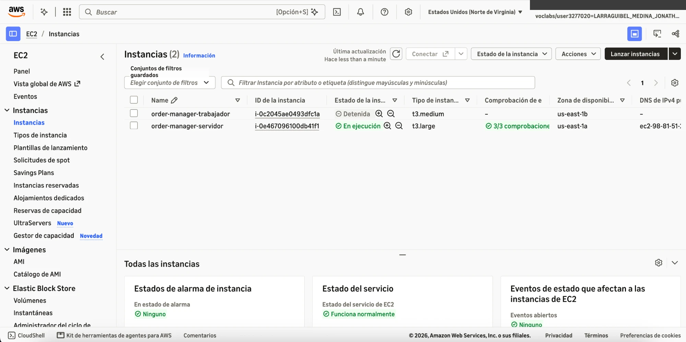

### Escalado automático

Con la versión nueva en ejecución, el HorizontalPodAutoscaler pasó de 1 a 2 réplicas al superar el objetivo de CPU, una en cada nodo: [registro](evidencias/ep3/33-escalado-hpa.txt).

## 2. Monitoreo y trazabilidad (IE1)

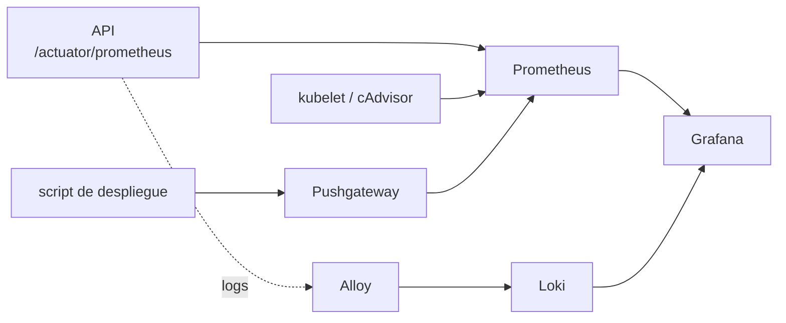

| Herramienta | Versión | Función |
|---|---|---|
| Prometheus | 3.5.0 | recolecta métricas cada 15 s y evalúa las alertas |
| cAdvisor (kubelet) | incluido en Kubernetes | CPU y memoria por contenedor |
| Pushgateway | 1.11.1 | recibe las métricas del pipeline |
| Loki y Alloy | 3.5.0 y 1.9.1 | recolectan y consultan los logs |
| Grafana | 12.0.2 | dashboard |

Prometheus descubre la API por las anotaciones del pod, así que cada réplica nueva se monitorea sin cambiar la configuración. El monitoreo se instala junto con la aplicación, mediante el mismo despliegue.

| Aspecto | Cómo se observa |
|---|---|
| Disponibilidad | métrica `up` y paneles de disponibilidad |
| Uso | peticiones por segundo, CPU y memoria |
| Errores | respuestas 5xx, eventos de log de nivel error y logs en Loki |
| Latencia | percentil 95 por endpoint |
| Trazabilidad | imagen etiquetada con el commit y métrica `deploy_info` |

| Alerta | Condición | Severidad |
|---|---|---|
| `AplicacionNoDisponible` | la API no responde durante 1 minuto | crítica |
| `TasaDeErroresAlta` | más del 5% de respuestas 5xx durante 1 minuto | crítica |
| `ErroresEnLogs` | hubo errores en los logs en los últimos 5 minutos | advertencia |
| `LatenciaAlta` | percentil 95 sobre 1 s durante 2 minutos | advertencia |
| `MemoriaCercaDelLimite` | memoria sobre el 90% del límite durante 2 minutos | advertencia |

Las alertas se consultan en Prometheus y Grafana. No hay Alertmanager, por lo que no se envían notificaciones.

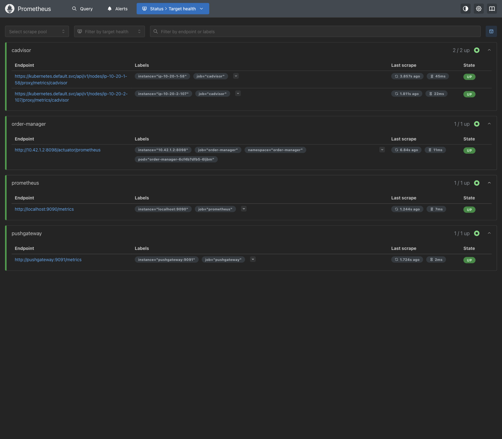

### Prueba de falla de la base de datos

En AWS se detuvo PostgreSQL dos veces y se enviaron 80 peticiones en cada caída; las 80 respondieron 500.

| Hora | Evento |
|---|---|
| 20:26:12 | Primera detención de la base de datos |
| 20:26:36 | Se activa `ErroresEnLogs` |
| 20:28:26 | Segunda detención |
| 20:29:21 | `TasaDeErroresAlta` pendiente (11% de respuestas 5xx) |
| 20:30:21 | `TasaDeErroresAlta` disparada |
| 20:31:21 | `LatenciaAlta` disparada (las peticiones esperaban 30 s a la base de datos) |

Tras reiniciar la aplicación, las primeras respuestas 500 crean la serie de la métrica y `rate()` no las cuenta; por eso la tasa de errores se reflejó en la segunda caída. [Registro completo](evidencias/ep3/31-falla-base-de-datos.txt).

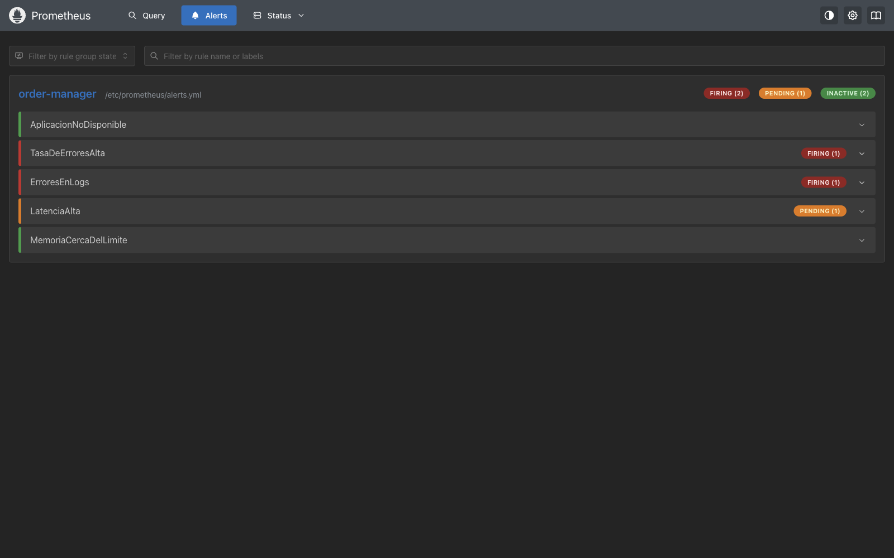

## 3. Dashboard (IE3)

El dashboard está versionado en `k8s/monitoring/dashboards/order-manager.json` y Grafana lo carga al iniciar.

| Fila | Paneles |
|---|---|
| Estado del servicio | disponibilidad actual y de 30 minutos, errores 5xx, alertas activas |
| Métricas del pipeline | tiempo de despliegue, cobertura, pruebas ejecutadas, commit desplegado |
| Uso, errores y latencia | peticiones por código HTTP, latencia p95 |
| Recursos | CPU y memoria por pod, memoria heap |
| Errores y logs | eventos de error y warning, alertas, logs |

Las métricas del pipeline llegan así: la etapa `test` calcula la cobertura y la cantidad de pruebas, la etapa `deploy` las entrega a `scripts/desplegar-k8s.sh`, y el script las publica en Pushgateway junto con la duración del despliegue y el commit.

Versión `5ba1503` en AWS durante la falla de la base de datos (32 s de despliegue, 96,7% de cobertura, 53 pruebas), con las tres alertas activas y los errores en los logs:

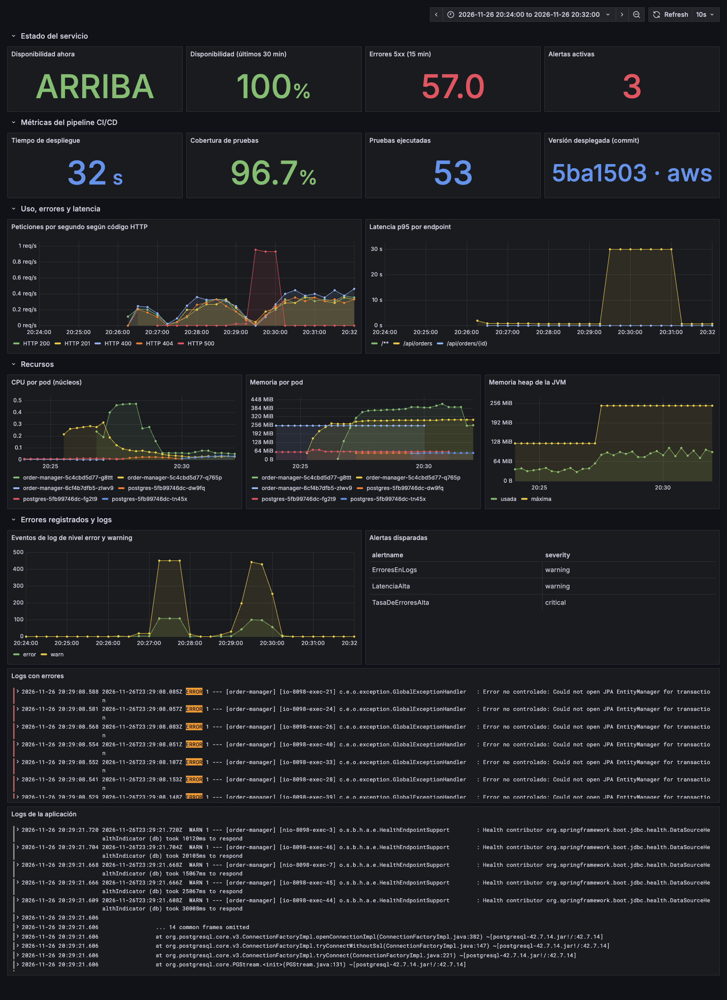

Las dos capturas siguientes corresponden a la versión `9e7e55f`, anterior a las mejoras de la sección 7.

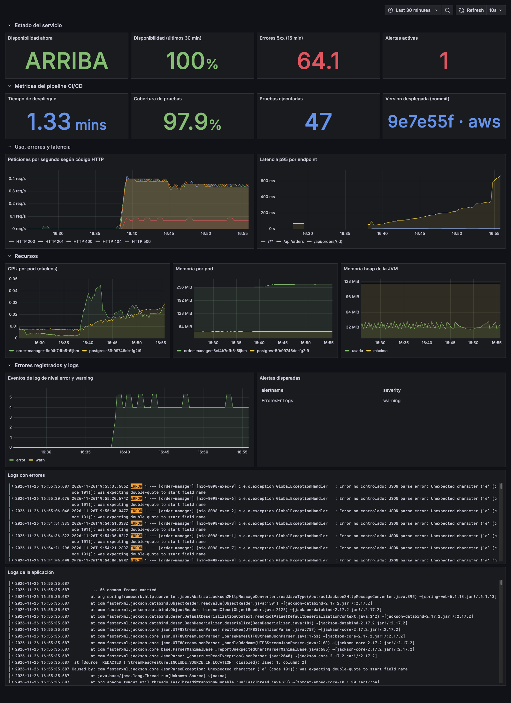

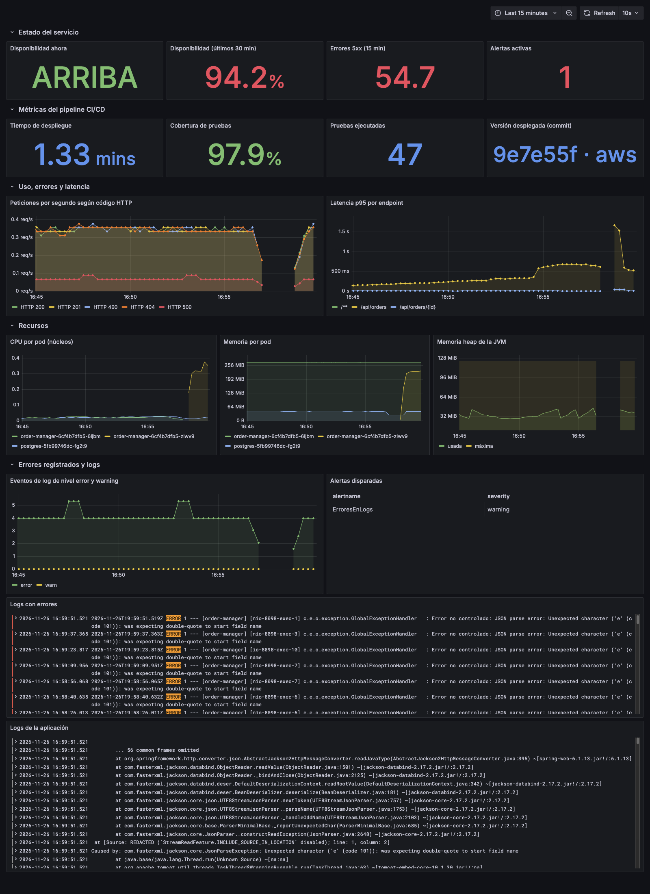

## 4. Integración en el pipeline (IE4)

Definido en `.github/workflows/ci-cd.yml`. Se ejecuta en cada `push` y pull request hacia `main` o `develop`.

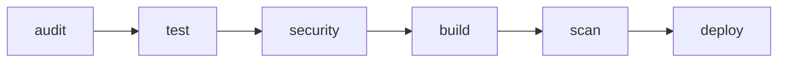

| Etapa | Herramienta | Qué hace | Se detiene si | Resultado que deja |
|---|---|---|---|---|
| `audit` | script propio y API de GitHub | revisa 12 políticas | alguna no se cumple | informe de auditoría |
| `test` | Maven y JaCoCo | pruebas y cobertura | falla una prueba o la cobertura es menor a 70% | reporte de cobertura |
| `security` | SonarCloud | análisis estático | no se cumple el quality gate | análisis en SonarCloud |
| `build` | Docker | imagen etiquetada con el commit | falla la construcción | imagen |
| `scan` | Trivy | vulnerabilidades, secretos y configuración | hay un hallazgo crítico o el escáner falla | reporte de seguridad |
| `deploy` | kind, Kustomize, Prometheus, Loki, Grafana | despliega y verifica el monitoreo | no responde la aplicación, las métricas, los logs, las alertas o el dashboard | evidencias de observabilidad |

En `deploy`, `scripts/verificar-observabilidad.sh` genera tráfico, detiene la base de datos del clúster de prueba para provocar errores reales y comprueba que métricas y logs los registren.

Ejemplo de ejecución completa: [run 45910078312](https://github.com/jhonnylarry/order-manager/actions/runs/45910078312) (commit `5ba1503`, 53 pruebas, cobertura 96,7%, despliegue en 49 s).

## 5. Políticas de cumplimiento (IE5)

`scripts/auditar-cumplimiento.sh` comprueba estas políticas en cada ejecución:

| Área | Política |
|---|---|
| Secretos | no hay archivos con credenciales en el repositorio |
| Secretos | las contraseñas se leen desde variables de entorno |
| Contenedores | la imagen no se ejecuta como root |
| Contenedores | las imágenes tienen una versión fija |
| Kubernetes | todos los contenedores tienen límites de recursos |
| Kubernetes | la API corre sin root, con sondas de salud y sin escalada de privilegios |
| Pipeline | la cobertura mínima exigida es de al menos 70% |
| Pipeline | SonarCloud bloquea si falla el quality gate |
| Pipeline | el despliegue exige el escaneo de seguridad |
| Pipeline | las acciones de GitHub usan una versión fija |
| Ramas | `main` está protegida |
| Ramas | `develop` está protegida |

La protección de ramas está definida en `.github/rulesets/proteccion-ramas.json` y aplicada en GitHub: exige pull request, impide el borrado y el force push, y requiere que las seis etapas del pipeline terminen en verde. No exige aprobaciones de otra persona porque el proyecto tiene un solo integrante.

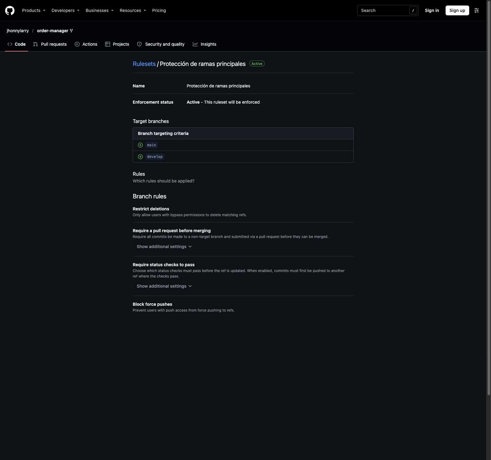

Además, SonarCloud aplica su quality gate y Dependabot propone cada semana actualizaciones de dependencias, imágenes y acciones.

## 6. Detención ante fallas críticas (IE6)

`scripts/escanear-seguridad.sh` detiene el pipeline ante:

1. vulnerabilidades críticas en la imagen;
2. secretos escritos en el repositorio;
3. configuraciones críticas en el Dockerfile o en los manifiestos.

Si el escáner no puede ejecutarse, el control tampoco se aprueba. Trivy se descarga en una versión fija y se verifica con su huella SHA-256.

**Pipeline bloqueado** ([run 45884865302](https://github.com/jhonnylarry/order-manager/actions/runs/45884865302)): se encontraron 9 vulnerabilidades críticas en Tomcat y Spring; el despliegue no se ejecutó. [Reporte](evidencias/ep3/22-seguridad-bloqueo.txt).

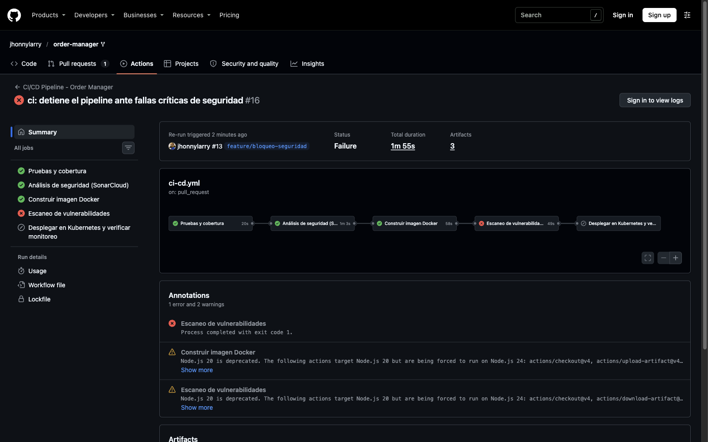

**Pipeline aprobado** ([run 45885247362](https://github.com/jhonnylarry/order-manager/actions/runs/45885247362)): tras actualizar a Spring Boot 4.1.3.

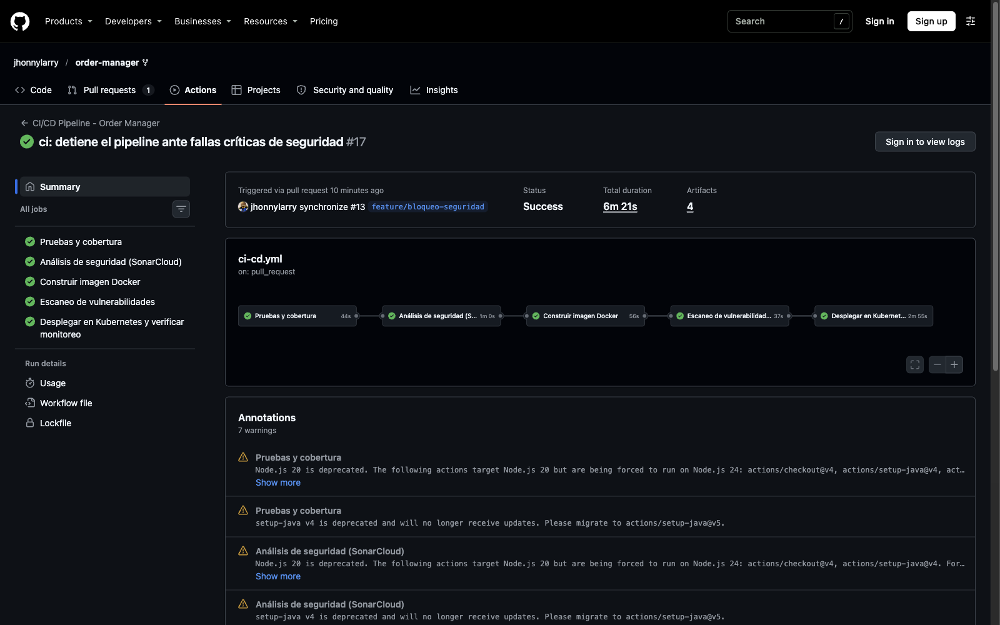

## 7. Uso de la información para decidir (IE4)

| Qué se observó | Dónde | Cambio realizado |
|---|---|---|
| 9 vulnerabilidades críticas | Trivy | actualización a Spring Boot 4.1.3 ([PR #13](https://github.com/jhonnylarry/order-manager/pull/13)) |
| Un JSON mal escrito respondía 500 y activaba `ErroresEnLogs` | Grafana, logs en Loki | los errores del cliente responden 400, 404, 405 o 415 ([PR #15](https://github.com/jhonnylarry/order-manager/pull/15)) |
| El pipeline rechazó el cambio anterior porque su verificación dependía de ese 500 | etapa `deploy` | la verificación provoca una falla real de la base de datos ([PR #15](https://github.com/jhonnylarry/order-manager/pull/15)) |
| La latencia p95 de `GET /api/orders` crece con la cantidad de pedidos | panel de latencia | sin cambios |
| Las primeras respuestas 500 tras un reinicio no cuentan en la tasa de errores | Prometheus | sin cambios |
| La API estuvo 108 s sin responder al caer su nodo | Prometheus y Grafana | sin cambios |

Verificación del segundo cambio en AWS: la versión `5ba1503` se desplegó en 32 s ([registro](evidencias/ep3/30-despliegue-aws-version-nueva.txt)) y un JSON mal escrito respondió 400.

### Mis decisiones técnicas

* 9 vulnerabilidades críticas en Trivy (PR #13): Decidí actualizar a Spring Boot 4.1.3 en vez de ignorarlas porque afectaban componentes expuestos (Tomcat y Spring) y suprimirlas habría anulado el propósito del bloqueo en el pipeline. Después: mantener las actualizaciones semanales de Dependabot y extender el bloqueo a vulnerabilidades de severidad alta.
* JSON mal escrito respondía 500 (PR #15): Decidí mapear los errores de entrada a códigos `4xx` porque una petición inválida del cliente no es una falla del servidor; contarlo como `500` distorsiona la disponibilidad real y genera falsos positivos en `ErroresEnLogs`. Después: estandarizar las respuestas de error con `ProblemDetail` (RFC 7807).
* Verificación del pipeline dependía de ese 500 (PR #15): Decidí modificar `scripts/verificar-observabilidad.sh` para detener PostgreSQL y provocar una falla real de infraestructura en lugar de depender de un defecto en el manejo de errores. Después: validar automáticamente que las alertas vuelvan a estado normal al recuperar la base de datos.
* Latencia p95 de GET /api/orders crece con los pedidos (sin cambios): No lo modifiqué ahora porque en operación normal se mantuvo en 0,6–0,7 s y solo superó 1 s de forma puntual tras un reinicio, sin sostenerse los 2 minutos que exige `LatenciaAlta`, por lo que prioricé las vulnerabilidades críticas y los falsos `500`. Qué haría: implementar paginación (`Pageable`) y evitar consultas N+1 al cargar ítems (`JOIN FETCH` o `@EntityGraph`).
* Primeros 500 tras reinicio no cuentan en rate() (sin cambios): Mantuve la consulta y documenté el comportamiento de Prometheus al crear una serie nueva, ya que `ErroresEnLogs` cubre esa ventana. Después: inicializar los contadores HTTP al arrancar la aplicación.
* 108 s de caída al detener el nodo trabajador (sin cambios): Lo acepto como línea base en este laboratorio de dos instancias, pero no sería aceptable en producción. Qué cambiaría: fijar un mínimo de 2 réplicas en el HPA con `podAntiAffinity` para distribuirlas entre nodos y absorber la caída de uno sin perder servicio.

## 8. Cómo reproducirlo

```bash
# Con un clúster de Kubernetes activo y la imagen order-manager:1.0.0 cargada
scripts/desplegar-k8s.sh 1.0.0
scripts/verificar-observabilidad.sh

# En AWS, con credenciales vigentes del laboratorio
infra/aws/crear.sh main
infra/aws/estado.sh
infra/aws/eliminar.sh
```

## 9. Conclusiones

El proyecto logró desplegar y validar los mismos manifiestos de Kubernetes en dos entornos (`kind` en CI/CD y `k3s` en AWS) con monitoreo completo, 12 políticas de cumplimiento automatizadas y bloqueo ante fallas críticas. Como limitaciones pendientes quedan el punto único de fallo en el nodo servidor (que aloja PostgreSQL y el monitoreo), la ausencia de Alertmanager para enviar notificaciones externas y el despliegue manual en AWS debido a las credenciales temporales del laboratorio.

Integrar el monitoreo y el bloqueo dentro del pipeline sirvió para convertir los datos en decisiones concretas: Trivy detuvo un despliegue con 9 vulnerabilidades críticas antes de llegar a ejecución, y Grafana junto a Loki permitieron detectar falsos errores `500` y corregir una prueba de observabilidad que no reflejaba fallas reales.

## 10. Uso de inteligencia artificial

> **Pendiente (completar por el estudiante):** declarar qué herramientas usé, para qué y cómo revisé los resultados.

## 11. Reflexión individual

En esta evaluación aprendí que tener un servicio "arriba" no basta: operar bajo enfoque DevOps exige medir disponibilidad, latencia y errores reales, y usar esa evidencia para decidir qué corregir. Lo que más me costó fue calibrar las pruebas de falla y entender comportamientos finos del monitoreo, como por qué rate() no contabilizaba los primeros 500 tras un reinicio y cómo provocar una caída real de PostgreSQL dentro del pipeline.

Al desarrollar todo el ciclo en solitario —desde la infraestructura en AWS y los manifiestos de Kubernetes hasta el monitoreo, las políticas de cumplimiento y el pipeline— me tocó asumir tanto la implementación técnica como el criterio para priorizar qué corregir de inmediato y qué dejar documentado como deuda técnica. Si tuviera que hacerlo de nuevo, partiría desde el inicio con 2 réplicas mínimas de la API para reducir el tiempo de indisponibilidad ante caídas de nodo e incluiría Alertmanager para recibir alertas activas.
